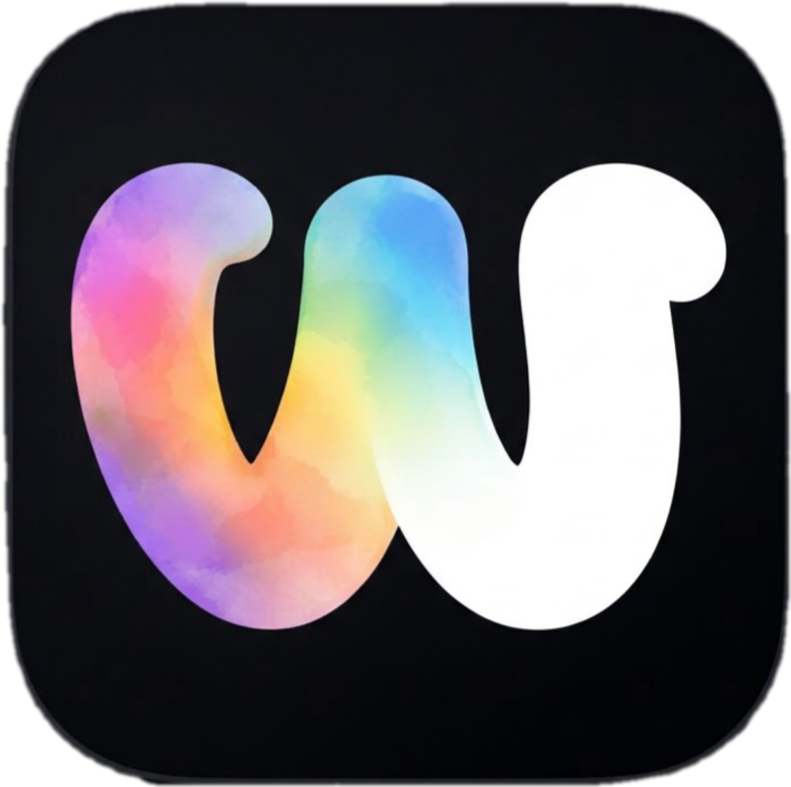

# WHATIF — Chess Continuation Workbench & Lichess Client

<div align="center">
  
</div>

> **Turn post-game chess regret into calibrated practice — and play live on Lichess inside a sleek Apple Studio Liquid Glass interface.**

**WHATIF** combines two things in one lightweight web & Android app:
1. **The WHATIF Continuation Engine (Offline / Post-Game)**: Load any completed PGN or synced Lichess game, rewind to the critical ply where things went wrong, and play out alternative lines against an engine throttled to your actual opponent's Elo — using either the built-in MIT tactical bot or your own imported **Stockfish `.js` + `.wasm`** running locally in a Web Worker.
2. **A Sleek Lichess Client (Online)**: Sign in with **Lichess OAuth2 PKCE**, paste a personal API token, or sync a public username to access live Board API games, Daily Puzzles & Puzzle Storm, Learn (Chess Basics, Practice & Community Studies), Live Lichess TV, Opening Explorer, Board Editor, and OTB Chess Clock.

---

## Highlights & Features

### Apple Studio Liquid Glass UI
- **Aurora Glass Aesthetics**: Deep obsidian backdrop (`#06080D`) layered with animated multi-spectrum aurora lighting, translucent frosted glass cards, and crisp minimal controls.
- **Gloss & Matte Chessboards**: Switch live between **Gloss Finish** (specular studio sheen + glossy Staunton vector pieces) and **Matte Finish** (tactile grain + diffuse piece lighting) across multiple board palettes (**Walnut**, **Emerald**, **Slate**, **Graphite**) under **More → Settings**.
- **Sleek Mobile-First Navigation**: 5-tab floating bottom pill dock (**Home · Puzzles · Learn · Watch · More**) paired with a Lichess-style floating **Play** pawn launcher (`Lobby Seek`, `Challenge Friend`, `Play Lichess AI`, `Practice Bot`, `Over the Board`).

### Smart Continuation Engine & Fair-Play Guardrails
- **Auto-Side & Auto-Elo Detection**: Automatically infers your color from your connected Lichess username(s), `Result` headers, or `Opponent_<ELO>` tags and sets `opponentElo` from game headers (`WhiteElo` / `BlackElo`), with live manual overrides inside the arena drawer.
- **Turn & Unfinished-Game Protections (`FairPlayError`)**: Enforces opponent-turn-only continuation and blocks engine assistance during unfinished or live online games (`live-lichess` mode runs strictly with zero engine involvement).
- **Local Stockfish `.js` + `.wasm` Browser Importer**: Upload your own single-file `stockfish.js` or paired `stockfish.js` + `stockfish.wasm` in **More → Settings**. Binaries are stored locally in IndexedDB and booted in an isolated Blob Web Worker (`UCI_LimitStrength` + `UCI_Elo`).

### Full Lichess Integration
- **Home**: Displays Rapid, Blitz, Bullet, and Puzzle ratings with progression deltas plus quick one-tap replay/exploration of your recent games into the WHATIF arena.
- **Play Sheet**: Seek rated/unrated lobby games, challenge Lichess Stockfish AI (Levels 1–8), challenge friends by username, or play Over the Board / local Practice Bot.
- **Puzzles**: Interactive Lichess Daily Puzzle trainer with streak feedback, Puzzle Themes, Puzzle Storm mode, and personal Puzzle Dashboard.
- **Learn & Watch**: Interactive tactical drills, browsable live Lichess community Studies, and live Lichess TV featured channels.
- **Tools**: Lichess Opening Explorer, interactive FEN Board Editor, and Over-the-Board digital Chess Clock.

---

## Quick Start (Web Development)

**Requirements**: Node.js `20+` and `npm`.

```bash
git clone https://github.com/eddygotamends/WHATIF.git
cd WHATIF
npm install
npm run lint     # Strict TypeScript check (tsc --noEmit)
npm run dev      # Start Vite dev server at http://localhost:3000
npm run build    # Output production bundle to dist/
```

---

## Android APK Packaging (Capacitor + GitHub Actions)

WHATIF ships with **`capacitor.config.json`** (`appId: "app.whatif.studio"`) and a ready-to-run CI workflow (**`.github/workflows/build-apk.yml`**):

- **Option 1 — Download Prebuilt APK**: In the running app, open **More → Download Android APK (.apk)** to download `WHATIF.apk`.
- **Option 2 — Automated GitHub Actions Build**: Push this repository to GitHub (`main`/`master`) or trigger **Actions → Build Android APK → Run workflow** to build `WHATIF-debug-apk` (`app-debug.apk`) in the cloud using Node 20 + JDK 21 + Capacitor Android.
- **Option 3 — Local Android Build**:
  ```bash
  npm install
  npm run build
  npm install --no-save @capacitor/core @capacitor/cli @capacitor/android
  npx cap add android
  npx cap sync android
  cd android && ./gradlew assembleDebug
  # Output: android/app/build/outputs/apk/debug/app-debug.apk
  ```

---

## Repository Structure

```text
├── GEMINI.md                         # Complete architecture & AI upgrade blueprint
├── FAIR_PLAY.md                      # Fair-play guardrails & online ToS policy
├── REVIEW.md                         # Ethical, licensing & privacy audit notes
├── capacitor.config.json             # Capacitor Android WebView config
├── .github/workflows/build-apk.yml   # Automated GitHub Actions Android APK builder
├── public/
│   ├── WL.png                        # App icon / logo
│   └── auth/lichess/callback/        # Popup callback for Lichess OAuth2 PKCE
└── src/
    ├── core/                         # WhatIfCore, ChessSession, FairPlayError & types
    ├── engine/                       # PracticeEngine, StockfishUciEngine & IndexedDB WASM importer
    ├── services/                     # Lichess OAuth PKCE, REST & NDJSON live game client
    ├── audio/                        # Procedural Web Audio move/capture/check cues
    ├── platform/                     # Browser Web Worker UCI transport
    └── components/                   # ChessBoard (Gloss/Matte), Puzzles, Learn, Watch, More & Modals
```

For AI coding assistants or developers extending the codebase, start by reading **[`GEMINI.md`](GEMINI.md)**.

---

## Fair Play & License Notice

- **Source License**: See [`LICENSE`](LICENSE) and [`THIRD_PARTY_NOTICES.md`](THIRD_PARTY_NOTICES.md). `chess.js` is BSD-2-Clause; any Stockfish binaries imported locally by the user remain under GPLv3.
- **Non-Affiliation**: WHATIF is an independent open-source chess project and is **not affiliated with, endorsed by, or connected to Lichess, Chess.com, LLC, or Stockfish**.
